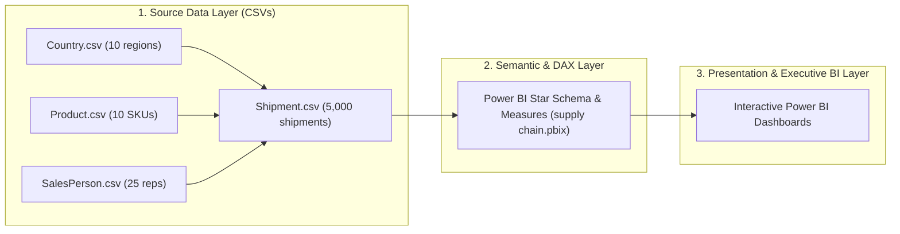
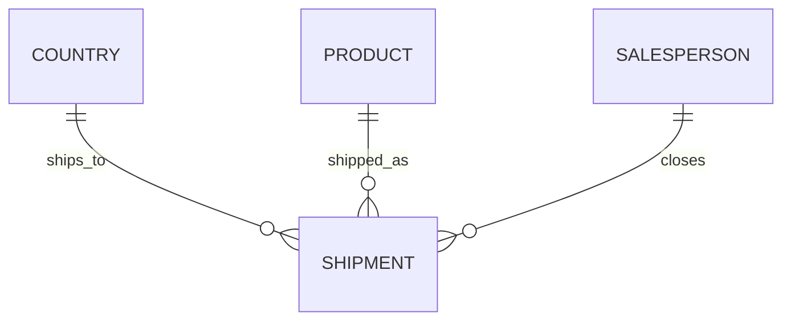

# Supply Chain Analytics Dashboard (`supply-chain-`) — Power BI Star-Schema Intelligence

## Table of Contents
- [Executive Summary & Business Utility](#executive-summary--business-utility)
- [System Architecture & Layers](#system-architecture--layers)
- [Data Model & Star Schema](#data-model--star-schema)
- [BI Metrics & Analytical Capabilities](#bi-metrics--analytical-capabilities)
- [Getting Started](#getting-started)
- [Business Value, ROI & Growth Opportunities](#business-value-roi--growth-opportunities)

---

## Executive Summary & Business Utility
`supply-chain-` is an executive Business Intelligence solution built in **Power BI** (`supply chain.pbix`) on a **5,000-row transactional shipment dataset** (`Shipment.csv`) joined with normalized dimension tables (`Country.csv`, `Product.csv`, `SalesPerson.csv`). It provides operations and sales leadership with immediate visibility into delivery SLA performance, regional revenue, product unit margins, and salesperson productivity.

---

## System Architecture & Layers

| Layer | Artifact | Role |
| :--- | :--- | :--- |
| **Dimension Layer** | `Country.csv`, `Product.csv`, `SalesPerson.csv` | Geographic markets, product cost catalog, and sales team roster |
| **Fact Layer** | `Shipment.csv` | 5,000 shipment transactions with status, delivery date, and sales amounts |
| **BI & DAX Layer** | `supply chain.pbix` | Relational star-schema model, KPI calculations, and visual drill-downs |

---

## Data Model & Star Schema

| File | Rows | Columns |
| :--- | :--- | :--- |
| `Shipment.csv` | 5,000 | `Shipment ID`, `Sales Person`, `Geography`, `Product`, `Date`, `Sales`, `Status`, `Delivered On` |
| `Country.csv` | 10 | `Geography`, `Region` |
| `Product.csv` | 10 | `Product`, `Category`, `Cost per Box` |
| `SalesPerson.csv` | 25 | `Sales Person`, `Team`, `Picture` |

---

## BI Metrics & Analytical Capabilities
- **Gross Margin & Costing**: Join `Shipment.Sales` against `Product[Cost per Box]` to track net profitability by product category and region.
- **Delivery SLA & Status Monitoring**: Track `Status` and `Delivered On` vs. `Date` to spot late corridors.
- **Sales Leaderboard**: Compare rep and team performance with photo-enriched cards (`SalesPerson.Picture`).

---

## Getting Started
1. Clone the repository: `git clone https://github.com/islamsamyy/supply-chain-.git`
2. Open `supply chain.pbix` in **Power BI Desktop**.
3. Update CSV data source paths if refreshing locally.

---

## Business Value, ROI & Growth Opportunities
- **Logistics Cost & SLA Optimization**: Pinpoints high-delay geographies and low-margin SKUs to cut freight waste.
- **Live ERP Gateway Upgrade**: Connect the star schema directly to `sotexerp` or `shamalelhejaz` Postgres views via Power BI Gateway for automated daily executive refreshes.
