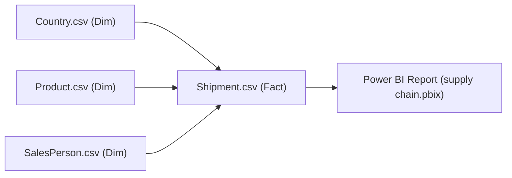

# Supply Chain Analytics Dashboard (`supply-chain-`)

An end-to-end Business Intelligence (BI) and logistics analytics solution built in **Power BI** (`supply chain.pbix`) using a normalized star-schema CSV data model (`Country.csv`, `Product.csv`, `SalesPerson.csv`, `Shipment.csv`).

---

## 1. Executive Summary & Purpose
`supply-chain-` transforms raw shipment records into executive-ready visibility across global logistics, product velocity, and sales representative performance.

## 2. Data Model & BI Layers

| Layer | Artifact | Role |
| :--- | :--- | :--- |
| **Dimension Tables** | `Country.csv`, `Product.csv`, `SalesPerson.csv` | Geographic regions, product catalog, and sales team attributes |
| **Fact Table** | `Shipment.csv` | Transactional shipment quantities, dates, and fulfillment metrics |
| **Semantic & Visual Layer** | `supply chain.pbix` | DAX measures, relationships, and interactive Power BI dashboards |

## 3. Business Value & Growth Opportunities
- **Inventory & Route Optimization**: Identifies underperforming regions, bottleneck corridors, and top-performing sales reps.
- **Live ERP Integration**: Connect the star schema directly to a transactional ERP database (such as `sotexerp`) via scheduled Power BI Gateway refreshes to replace static CSVs with near-real-time executive reporting.
